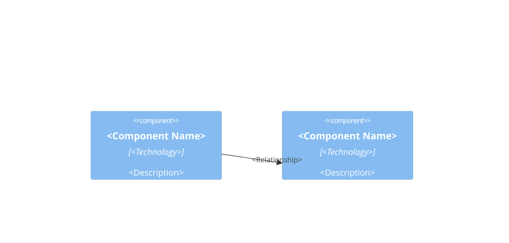

# Design: <Component>

## Goal

- <What the component does>
- Where it fits: <upstream> -> <this component> -> <downstream>

## Diagram

## Files and Import Graph

- `<file>`: <what lives here>
- `<file>` imports `<file>`

## One Request End to End

- <Step 1>
- <Step 2>

## Configuration, Interfaces, and Known Limits

- Configuration: <parameters and defaults>
- Interfaces: <endpoints, functions, CLI flags>
- Known limits: <limit>

## Deliberately Not Built

- <What is out of scope, and where it is tracked>

## Open Questions

1. <Question>
