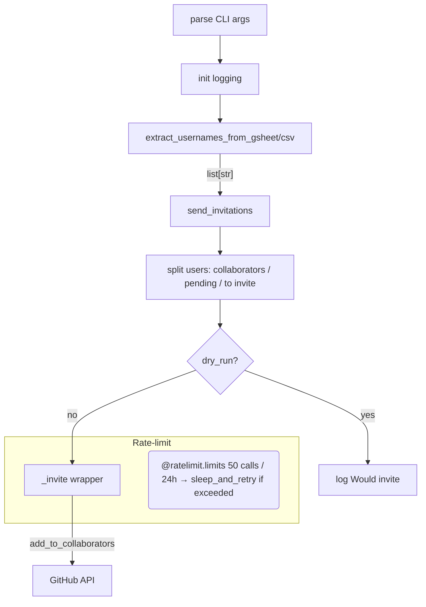

<!-- toc -->

- [`invite_gh_contributors.py` Explanation](#invite_gh_contributorspy-explanation)
## Public interface

```bash
# Google Sheet source
dev_scripts_helpers/github/invite_gh_contributors.py \
    --drive_url <google-sheet-url> \
    --org_name  <github-org>       \
    --repo_name <repo>             \
    [--no_skip_invited] [--dry_run] [-v INFO]

# CSV source (mutually exclusive with --drive_url)
dev_scripts_helpers/github/invite_gh_contributors.py \
    --csv_file  </path/to/users.csv> \
    --org_name  <github-org>         \
    --repo_name <repo>               \
    [--no_skip_invited] [--dry_run] [-v INFO]

# Users passed on the command line (mutually exclusive with the sources above)
dev_scripts_helpers/github/invite_gh_contributors.py \
    --add_gh_user <user> [--add_gh_user <user> ...] \
    --org_name    <github-org>                      \
    --repo_name   <repo>                            \
    [--permission pull] [--no_skip_invited] [--dry_run] [-v INFO]
```

- **`drive_url`/`csv_file`**: Spreadsheet containing a `GitHub user` column.
- **`add_gh_user`**: GitHub user name to invite. It can be repeated.
- **`permission`**: permission granted to the invited users (default `write`).
- **`GITHUB_TOKEN` env var**: PAT with `repo` scope (or fine-grained "Repository
  administration"). If unset, the token from `gh auth token` is used.
- **`org_name` / `repo_name`**: identify the target repository.
- **`skip_invited`**: invite only the passed users that are neither
  collaborators nor have a pending invitation (on by default).
- **`dry_run`**: log who would be invited without inviting anyone.
- **`-v`**: standard log level.

## Execution flow



## Key implementation choices

- **Dependencies via `uv`**: the `uv run` shebang and the inline `# /// script`
  block install the dependencies into a cached environment, so no separate
  requirements file or Docker image is needed.
- **Service-account auth**: the key is read from the default path used by
  `hgoogle_drive_api.get_credentials()`
  (`~/.config/gspread_pandas/google_secret.json`).
- **Idempotence**: the passed users are diffed against the repo collaborators
  and the pending invitations (case-insensitive), so users already invited are
  not invited again and do not count toward the daily quota.
- **Dry run**: only the `add_to_collaborators` call is guarded by `--dry_run`,
  so the diff is still computed and logged.
- **Sleep strategy**: we rely entirely on `ratelimit.sleep_and_retry`, so the
  process may block for hours. Even if the process is terminated, the
  idempotence measure will prevent the added names from contributing to the
  quota
